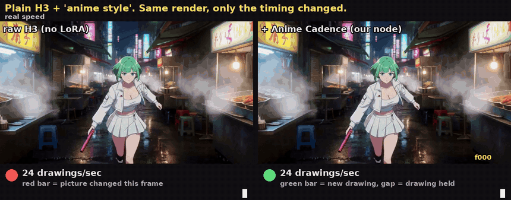
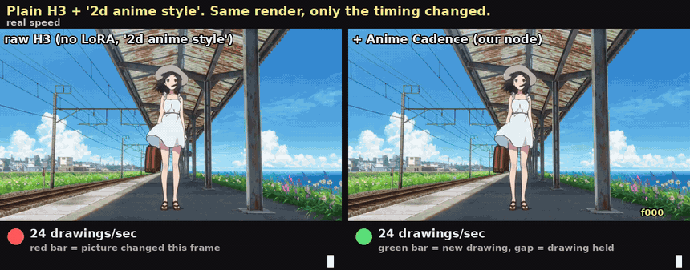
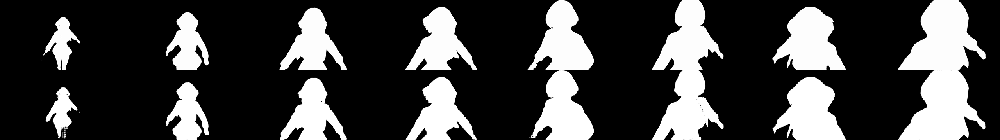
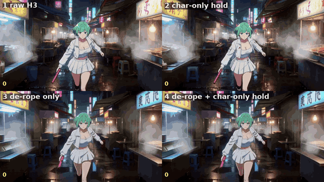
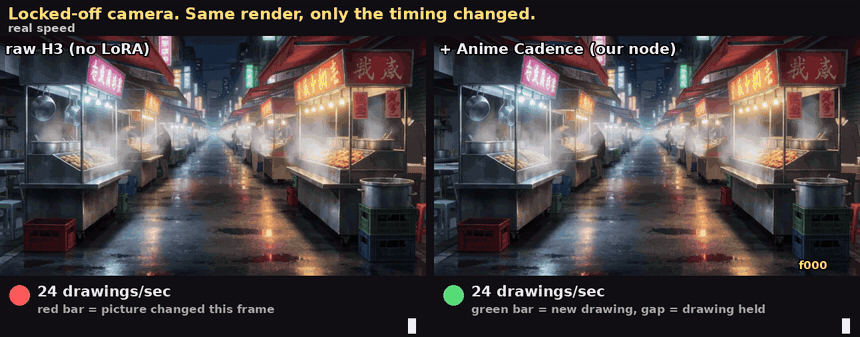

# ComfyUI-H3-AnimeCadence

Nodes for making **MiniMax H3** video move like hand-drawn anime: drawings held on **2s / 3s**
instead of a new picture every frame. Includes a **character-only** mode that holds the character
while the background and camera keep moving smoothly, the way anime is actually shot.



*Plain H3 (no LoRA). Left: raw output, a new picture every frame (24 drawings/s). Right: the same
frames through **Anime Cadence**, each drawing held for 2 frames (12/s). The bars show when the
picture actually changes.* ([mp4](assets/demo_anime_cadence.mp4))



*Plain H3 (no LoRA), "2d anime style". H3 animates her on 2s by itself in the close-up, then slips to
a new picture every frame when the train pulls in and the wind hits (24/s). Anime Cadence puts that
ending back on 2s (12/s); the rest stays as H3 drew it.* ([mp4](assets/demo_anime_cadence_train.mp4))

---

## The idea in one paragraph

In animation, 24 fps doesn't mean a new drawing every frame. Most anime holds each drawing for
2 or 3 frames ("on twos / threes"). H3 mostly knows this: write a style word like *"2d anime style"*
and it animates characters on 2s by itself. But it slips back into a new picture every frame (the
smooth, floaty, CG look) when the **camera moves** or during **fast physical motion** (trains, wind,
flying objects). These nodes find those stretches and re-time them onto 2s/3s, following the timing
H3 already chose, and keep the sharpest frame of each held drawing.

These nodes fix **timing**. Fast-motion **smearing/melting** is a different problem; the fix for that
is the de-rope pipeline in [ComfyUI-MAINodes](https://github.com/matlowai/ComfyUI-MAINodes). Workflow 06
chains the two (07 without SAM).

### What's ours, and what isn't

- **Ours:** the five nodes in this repo (re-timing with auto 2s/3s detection and sharpest-frame pick,
  character-only holds, the SAM tracker, the measure node, the experimental hold guide), the example
  workflows, the demo/analysis tools, and the test results in "What we learned".
- **Not ours:** the de-rope that fixes smearing is **MAINodes** (matlowai), used unmodified in workflows 06 and 07,
  with settings that follow MAINodes' own recommended fast flow. The framing of the problem, cadence as the
  thing video models get wrong and the way we measure it, comes from **Alvdansen Labs' "Animating on Twos"**.
  Masks come from **SAM / SAM2** (Meta, via Kijai's nodes), the tiny VAE from **madebyollin**, the video
  model from **MiniMax**. Holding drawings on 2s/3s is ordinary animation practice. See [Thank you](#thank-you).

---

## Nodes

| node | what it does | example workflow |
|---|---|---|
| **Anime Cadence: Hold on 2s/3s** | re-times any clip onto 2s/3s; `auto` follows the hold length + phase H3 already chose; keeps the sharpest frame of each hold | [01](example_workflows/01_anime_cadence_on_a_clip.json), [02](example_workflows/02_h3_t2v_plus_anime_cadence.json), [07](example_workflows/07_derope_plus_anime_cadence.json) |
| **Anime Cadence: Character Only** | holds only the masked character on 2s/3s; background/camera stay on ones | [03](example_workflows/03_character_cadence_sam2.json), [04](example_workflows/04_character_cadence_sam_v1.json), [06](example_workflows/06_derope_plus_character_cadence.json) |
| **Character Mask Track (SAM)** | per-frame character mask from one click, using the original Segment Anything (SAM v1) | [04](example_workflows/04_character_cadence_sam_v1.json) |
| **Anime Cadence: Measure** | prints how much of a clip is on 1s / 2s / 3s | [01](example_workflows/01_anime_cadence_on_a_clip.json) |
| **H3 Hold Guide** *(experimental)* | in-sampler nudge toward held drawings via the tiny taeh3 VAE | [05](example_workflows/05_hold_guide_experimental.json) |
| **H3 Window Attention** | temporal window attention for the long de-rope pass: ~40% faster pass 2, fast poses stay crisp | [08](example_workflows/08_fast_derope_plus_anime_cadence.json) |
| **Motion Gate** + **Segment Splice** | de-rope only sustained extreme motion: measures pass 1 with optical flow, redraws just the burst and splices it back; calm clips skip pass 2 | [08](example_workflows/08_fast_derope_plus_anime_cadence.json) |
| **Scout Sigmas** *(experimental)* | stops a sampler early at a target sigma (for experiments; not used by 08) | |
| **Load TAE as VAE (taeh3)** | loads a tiny video autoencoder from `models/vae_approx` as a normal VAE for VAEEncode/VAEDecode | [08](example_workflows/08_fast_derope_plus_anime_cadence.json) |

Drag any `.json` from [`example_workflows/`](example_workflows/) onto the ComfyUI canvas (they also
show up in ComfyUI's template browser under this pack).

### Anime Cadence: Hold on 2s/3s

`images` in, same number of frames out, re-timed.

1. Measures how much the picture changes frame to frame.
2. Splits the clip into hold slots (one per drawing). `auto` tries "every 2" and "every 3" at every
   starting phase and picks the one that best matches the changes H3 already made.
3. In each slot, keeps one frame and repeats it. `pick = sharpest` uses the frame with the crispest
   lines (Laplacian variance), so smeared in-betweens are dropped.

| widget | meaning | used in |
|---|---|---|
| `mode` | `auto` (recommended), `auto_twos`, `auto_threes`, `twos`, `threes`, `fours`, `adaptive` (new drawing once the image has moved enough: fast → 2s, slow → 3s/4s) | always |
| `pick` | `sharpest`, `first` (keeps one-frame impact flashes), `middle` | always |
| `min_hold` / `max_hold` / `sensitivity` | bounds and eagerness of `adaptive` | adaptive only |
| `offset` | starting phase | fixed modes only |

Outputs: `images`, `report` (e.g. *"107 frames → 54 drawings (12.1 drawings/s). holds: 2s ×53"*), `drawing_starts`.

### Anime Cadence: Character Only (+ SAM2 or Character Mask Track)


*Left: raw H3. Middle: whole-frame hold (camera move also steps on 2s). Right: character-only hold:
she's on 2s, the street, steam and camera move every frame.* ([mp4](assets/demo_character_cadence.mp4))

A mask gives the character's shape per frame. For each hold slot the node pastes the held drawing of
the character (union of the held and current mask, grown by `grow` px, soft edge `feather` px) over the
**current** frame. So the character changes every 2–3 frames while the background stays live.

Masks: **SAM2** ([kijai/ComfyUI-segment-anything-2](https://github.com/kijai/ComfyUI-segment-anything-2),
workflow 03; give 2–3 pixel points on the character in frame 0), or **Character Mask Track (SAM)** (workflow 04;
one click as a fraction of the frame, uses the SAM v1 checkpoint in `models/sams`). SAM2 gives cleaner masks:



### De-rope + Anime Cadence (workflows 06 and 07)



*1 raw | 2 character-only hold | 3 MAINodes de-rope | 4 de-rope + character-only hold.*
([mp4](assets/demo_derope_plus_character_cadence.mp4))

This part is **MAINodes' de-rope pipeline**, used as published. Pass 1 is a normal H3 render. MAINodes
finds spans that move too fast for H3's 4-frame latent tokens (their explanation of why H3 smears), slows
them down, and pass 2 redraws them. The settings follow MAINodes' recommended fast flow (turbo LoRA on
pass 2; we used 0.8 strength, an 8-step schedule and `inject 0.5`, which kept pass 1's acting in our tests).
Exact Recover returns to real time. Our part is the last step: in **06**, SAM2 + Anime Cadence: Character
Only put the character on 2s; **07** is the simpler version with no SAM, where Anime Cadence holds the whole
frame (best when the camera is mostly still). About 2× the time of a single render.

### Fast de-rope (workflow 08): same fix, extra cost roughly halved

**Why H3 smears**: we tested it directly. H3's VAE round-trips crisp fast poses at normal 24 fps almost
losslessly, so one latent token *can* hold four distinct fast poses. It's the DiT that paints the blur: it
re-smears even a clean clip when re-rendering it at normal speed. In mostly live-action training data, fast
motion inside a latent token comes with motion blur. The de-rope's frame holds give each fast pose its own
static token, which is why it works.

**Where the de-rope's cost goes**: the slowed clip is 2.3-3.3x longer, and full attention grows with the
square of its length, so pass 2 costs 5-8x a normal step.

**H3 Window Attention** (this pack) fixes that for the de-rope pass. Each video frame attends exactly to its
neighbours (±4 latent frames), every 8th frame as an anchor, and all text/audio/first-frame rows. Text and
audio still attend to everything. Pass 2 runs about 40% faster, and in our tests fast poses came out as crisp
as with full attention or crisper; long-range attention seems to average fast poses together. It is not a
one-pass fix: from step 0 of a normal render it just gives a different take. It needs the de-rope's init.

Also in 08: taeh3 (*Load TAE as VAE*) does the throwaway decode and the encode of the slowed clip
(34 s -> 2 s), and the int8 video VAE does the final decode. Pass 1 and its audio are a normal render.

**Motion Gate: de-rope only where it's needed.** MAINodes' Jerk Oracle ranks motion against the clip itself, so it
always slows the fastest ~25% of every clip, including talking heads and shot cuts. In our tests that made redrawn
mouths look off. *Motion Gate* measures motion in absolute terms instead: optical flow on the pass-1 frames, with
camera pans removed, summed over 4-frame windows (one H3 latent token). Only motion above 0.09 frame widths per window,
lasting at least 5 windows, counts. Isolated whole-frame changes are treated as shot cuts and ignored; clustered ones
(explosions, flashes) count as action. Inside those spans the oracle's own slow-down is used. The burst plus 12-frame
handles is redrawn and *Segment Splice* crossfades it back into the full-quality pass-1 render. If nothing is extreme,
the splice never requests pass 2, so it doesn't run. Calibrated on 13 clips: dialogue and dance never trigger it;
punches, crashes, sword fights and falls trigger on their bursts. Known miss: a brief flash-melt with little sustained
motion.

Measured on an RTX 5090, 1024x576x124: Re:Zero i2v 246 s -> 167 s, sword-fight prompt 231 s -> 158 s
(a plain render is ~100 s); with the Motion Gate a calm dialogue clip costs the same as a plain render, and a 15 s fight at 1 MP cost 1.19x. Same choreography and the same smear fixes as 07 on Edgerunners, Re:Zero, Teen
Titans and Golden Boy test clips.

### H3 Hold Guide (experimental)

Each sampling step the predicted video is decoded with the tiny **taeh3** VAE, held on the 2s/3s the model
is already choosing, re-encoded, and the prediction is nudged toward it. In our tests it never hurt and
cost ~10%, but the average effect was mild. Anime Cadence after decode does most of the work.
`width/height/length` must match the H3 Image-to-Video node.

---

## Install

```bash
cd ComfyUI/custom_nodes
git clone https://github.com/tazmannner/ComfyUI-H3-AnimeCadence
```

Restart ComfyUI. Core nodes need nothing beyond ComfyUI. Optional, per workflow:

| for | install |
|---|---|
| all example workflows (video load/save) | [ComfyUI-VideoHelperSuite](https://github.com/Kosinkadink/ComfyUI-VideoHelperSuite) |
| workflows 02, 05, 06 | MiniMax H3 models in ComfyUI: `minimax_h3_fl2va_pruned_int8_convrot`, `qwen3vl_32b_minimax_h3_*`, `minimax_h3_video_vae_fp16` (see [Comfy-Org/MiniMax-H3](https://huggingface.co/Comfy-Org/MiniMax-H3)) |
| workflows 03, 06 (SAM2 masks) | [kijai/ComfyUI-segment-anything-2](https://github.com/kijai/ComfyUI-segment-anything-2) (downloads `sam2.1_hiera_base_plus`, ~160 MB, on first run) |
| workflow 04 (Character Mask Track) | `pip install segment-anything` and a SAM v1 checkpoint (e.g. `sam_vit_b_01ec64.pth`) in `models/sams` |
| workflow 08 (Motion Gate) | OpenCV (`pip install opencv-python-headless`; most ComfyUI installs already have it) |
| workflows 05, 08 (Hold Guide, fast de-rope) | `taeh3.safetensors` from [madebyollin/taehv](https://github.com/madebyollin/taehv) in `models/vae_approx` (needs the version with an encoder) |
| workflows 06, 07 (de-rope) | [matlowai/ComfyUI-MAINodes](https://github.com/matlowai/ComfyUI-MAINodes) + any H3 turbo LoRA |

## What we learned testing H3

- **H3's VAE keeps twos.** The Animating on Twos paper lists this as an open risk; in our measurement real
  on-twos anime survived H3's encode→decode almost perfectly, so the every-frame motion comes from the
  generator, not the latent format.
- **"2d anime style" switches on anime timing.** Same prompt/seed without style words, H3 renders live
  action and changes every frame. With them, characters go on 2s. A LoRA trained on *still images* changes
  the look, not the timing.
- **Camera motion is what pushes H3 back to ones.** With a locked-off camera, H3 already animates the
  character on 2s and these nodes change almost nothing:

  

- **A LoRA trained on real anime clips (native 24 fps) learns the timing itself**: in our test it was
  ~98% on twos for the whole frame, and these nodes had nothing to fix. This agrees with the Animating on
  Twos paper's case that fine-tuning on real cadence is the real fix. The nodes matter most for plain H3
  and image-trained style LoRAs.
- **Never resample anime training clips to 25/30 fps.** Duplicated frames break the 2/3 pattern.
- **Smear/melting is a different problem from timing.** MAINodes' de-rope fixes it (their work, not ours); on
  our hardest prompts it turned melted bodies and white smears back into readable drawings.

## Tools (no ComfyUI needed)

- `tools/cadence_analyze.py clip.mp4` measures a clip's cadence (1s/2s/3s histogram, per-tile, optional
  camera-pan compensation). The measurement method follows Appendix C of the Animating on Twos paper.
- `tools/showcase.py out.mp4 raw.mp4 retimed.mp4 [--realtime-only]` makes the side-by-side demo with the
  drawing-change ticker used in the GIFs above.

Both need `ffmpeg`, `numpy` and `Pillow`.

## Limitations

- Holding the whole frame on a moving camera also steps the camera; use Anime Cadence: Character Only for those shots.
- `pick = sharpest` can swap an intended one-frame impact flash for a neighbouring crisp drawing (use `first`).
- Character Only mode: one prompt per shot; a thin soft edge around the character shows one frame of older
  background during fast camera moves (raise `feather`).
- Tested on MiniMax H3 at 768×576 and 1024×576, 4–15 s clips, by eye on the fastest frames. Not a benchmark.

---

## Thank you

This work stands on other people's generosity. Big thanks to:

- **matlowai** for [ComfyUI-MAINodes](https://github.com/matlowai/ComfyUI-MAINodes)
  ([demo page](https://matlowai.github.io/ComfyUI-MAINodes/)). The de-rope pipeline is the real fix for
  fast-motion smearing in H3, and its README explains *why* H3 smears better than anything else we found.
- **Minta Carlson and Timothy Bielec of [Alvdansen Labs](https://github.com/alvdansen)** for
  ["Animating on Twos: Training Keyframe-Animation Adapters on a Pretrained Video Model"](https://github.com/alvdansen/animating-on-twos)
  and their [H3 keyframe-animation adapters](https://huggingface.co/alvdansen/h3-keyframe-animation).
  Their paper framed the whole problem: cadence is the axis video models drift on and metrics can't see.
- **MiniMax** for releasing [MiniMax H3](https://huggingface.co/MiniMaxAI/MiniMax-H3) as open weights.
- **Kijai** for [ComfyUI-segment-anything-2](https://github.com/kijai/ComfyUI-segment-anything-2) and the
  converted SAM2 weights, and **Meta AI** for [Segment Anything](https://github.com/facebookresearch/segment-anything)
  and SAM2.
- **madebyollin** for [taehv / taeh3](https://github.com/madebyollin/taehv), the tiny H3 VAE.
- **Kosinkadink** for [ComfyUI-VideoHelperSuite](https://github.com/Kosinkadink/ComfyUI-VideoHelperSuite) and
  the [ComfyUI](https://github.com/comfyanonymous/ComfyUI) team.
- **[Claude](https://www.anthropic.com/claude) (Anthropic)**, via Claude Code, which wrote the nodes, tools
  and example workflows, ran the experiments and comparisons behind the findings above, and put together
  this repo, working from tazmannner's direction, testing and review.

## Credits and related work (details)

All code in this repository was written for this project; no code was copied from the projects below.

- **ComfyUI-MAINodes** by matlowai (GPL-3.0). Its de-rope pipeline (H3 Jerk Oracle, Time Smear, V2V Init,
  Inject Schedule, Exact Recover) is what fixes fast-motion smearing; example workflows 06 and 07 *use* those nodes
  unmodified (install MAINodes separately). The explanation that H3 smears because one latent token spans
  four frames is theirs.
- **"Animating on Twos"** by Minta Carlson and Timothy Bielec, Alvdansen Labs (text CC BY 4.0). Ideas used
  (no code, adapters or workflows from that repo are used here):
  - the cadence measurement in `tools/cadence_analyze.py` (held-frame run length with a threshold relative to
    the clip's own step distribution) follows their Appendix C;
  - our dataset cadence-tagging approach follows their caption guidance (§5: cadence words like "on twos" only
    where literally true, no negations);
  - "on twos by holding every other drawing" (their Appendix E; also standard animation practice) is the idea
    our fixed twos mode applies after rendering;
  - their argument that video models drift to smooth "hedged" motion and that pixel metrics are blind to
    cadence shaped our evaluation (graded by eye on the fastest frames).
- **Segment Anything** (Meta, Apache-2.0) for SAM v1; **SAM2** via Kijai's ComfyUI-segment-anything-2.
- **taeh3** tiny VAE by madebyollin (taehv).
- Laplacian-variance sharpness and "on twos" holds are standard image-processing / animation practice.
- Demo clips are plain MiniMax H3 renders (no LoRA) made for this project.

## License

[MIT](LICENSE). Example workflows 06 and 07 use nodes from ComfyUI-MAINodes (GPL-3.0), which you install
separately; no MAINodes code is included in this repository.
